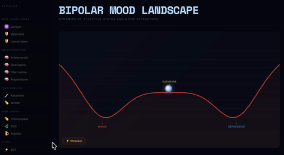

# Bipolar Attractors

A visual model of bipolar disorder as a dynamic energy landscape — mood is a ball rolling between mania, euthymia, and depression, and each drug reshapes the terrain.

**[Try it live →](https://bipolar.kisielos.com)**

<p align="center">
  
</p>

---

## The idea

Imagine mood as a landscape of hills and valleys. In bipolar disorder, euthymia is an unstable hilltop — any push sends the ball rolling toward mania or depression. Medications don't just treat symptoms; they reshape this terrain.

- **Lithium** makes euthymia a deep stable valley; mania and depression flatten out
- **Antipsychotics** raise a barrier in front of the manic region
- **Benzodiazepines** add friction — the ball slows — without reshaping the hills
- **Stimulants / alcohol** tilt and destabilize the whole landscape

Based on attractor theory applied to mood disorders. Key paper: [A critical evaluation of dynamical systems models of bipolar disorder (Nature, 2022)](https://www.nature.com/articles/s41398-022-02194-4).

---

## Contributing

The simulation is only as good as its parameters. **The most valuable contributions don't require coding** — they require clinical or lived knowledge.

If you're a psychiatrist, researcher, or patient, you can help by questioning whether a drug's behavior matches reality, proposing parameter values backed by evidence, or adding new substances.

**[Open an issue](https://github.com/ciessielski/bipolar/issues)** — you don't need a solution, raising a question is enough.

### Parameters

Each substance is a YAML file in [`src/data/modifiers/`](src/data/modifiers/). Use [`_template.yaml`](src/data/modifiers/_template.yaml) as a starting point.

| Parameter | What it controls |
|-----------|-----------------|
| `wells[mania/euthymia/depression].depth` | How "sticky" each state is — 0 = unstable hilltop, higher = deeper attractor |
| `wells[*].w` | Width of the basin of attraction |
| `gravity` | How forcefully mood shifts toward attractors |
| `damping` | Friction (0–1) — lower = ball loses energy faster (sedation) |
| `jitter` | Random noise — restlessness, agitation |
| `barrierH` | Barrier height in front of mania — models D2 blockade |
| `halfLife` | Elimination half-life in hours |
| `onset` | Hours until meaningful clinical effect |
| `warnings` | Clinical warnings; prefix `[Black box]` for FDA black box warnings |

The three wells are ordered left to right: **mania**, **euthymia**, **depression**.

Unmedicated baseline: mania + depression depth = 2.2, euthymia depth = 0 (unstable), gravity = 14, damping = 0.985.

### Submitting a PR

1. Fork the repo
2. Edit an existing file in `src/data/modifiers/` or copy `_template.yaml` for a new substance
3. Add references:
   ```yaml
   refs:
     - cite: "Author et al. Title. Journal, Year."
       url: "https://pubmed.ncbi.nlm.nih.gov/..."
   ```
4. Open a PR with your clinical or scientific rationale

---

## Running locally

```bash
npm install
npm run dev
```

---

## License

MIT
